<div align="center">

  

  # Spendly — Smart Personal Finance & Expense Tracker

  <p align="center">
    <strong>A calm, modern, and 100% offline-first personal finance app crafted with React Native & Expo.</strong>
  </p>

  <p align="center">
    <a href="#-key-features--user-benefits"></a>
    <a href="#-tech-stack"></a>
    <a href="#-tech-stack"></a>
    <a href="#-tech-stack"></a>
    <a href="#-tech-stack"></a>
    <a href="#-strict-intellectual-property-anti-cloning--commercial-use-notice"></a>
    <a href="#-strict-intellectual-property-anti-cloning--commercial-use-notice"></a>
  </p>

  <p align="center">
    <a href="#-app-showcase--ui-gallery">View UI Screenshots</a> •
    <a href="#-key-features--user-benefits">User Benefits</a> •
    <a href="#-how-to-use-spendly">How to Use</a> •
    <a href="#-tech-stack">Tech Stack</a> •
    <a href="#-getting-started">Getting Started</a>
  </p>

</div>

---

## 🌟 Overview & Philosophy

**Spendly** is built around a simple principle: **Managing money should bring clarity, not anxiety.**

Most finance apps today bombard users with third-party ads, aggressive bank scraping, and cluttered spreadsheets. Spendly redefines personal bookkeeping with:
1. **Soft Aesthetic UI**: Calming pastel palettes (Sage Green `#5BAF85`, Soft Coral `#E07878`, Cloud Mint `#F4F6F3`) and smooth tactile haptics.
2. **True Data Sovereignty**: All your transactions, wallets, and budgets reside exclusively on your phone in a high-speed SQLite database. No external servers, no tracking, no subscription paywalls.
3. **Sub-second Logging**: A customized numeric keypad lets you record any transaction in under 3 seconds.

---

## 📱 App Showcase & UI Gallery

All screenshots below are captured directly from real device testing.

### 1. Home Dashboard & Spending Analytics
<table>
  <tr>
    <td width="50%" align="center">
      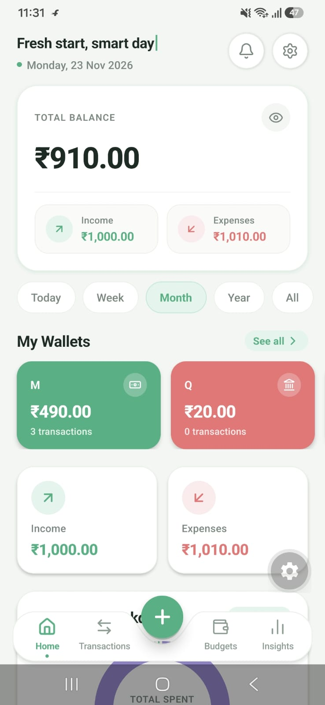<br />
      <b>01. Home Dashboard Overview</b><br />
      <i>Instant net-worth balance, privacy eye toggle, income/expense breakdown, time filters, and multi-wallet cards.</i>
    </td>
    <td width="50%" align="center">
      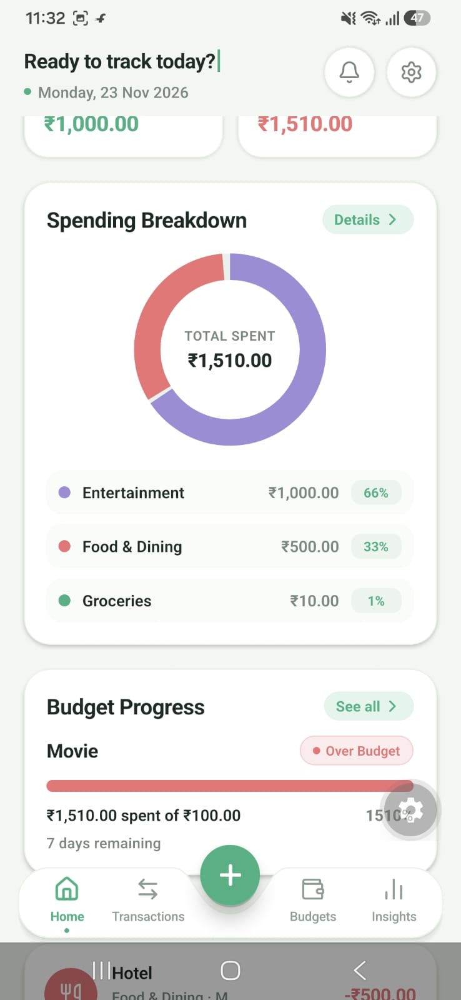<br />
      <b>02. Spending Breakdown & Budget Progress</b><br />
      <i>Dynamic interactive donut chart by category with percentage distribution and real-time budget limit alerts.</i>
    </td>
  </tr>
</table>

---

### 2. Fast Keypad & Multi-Type Transactions
<table>
  <tr>
    <td width="33%" align="center">
      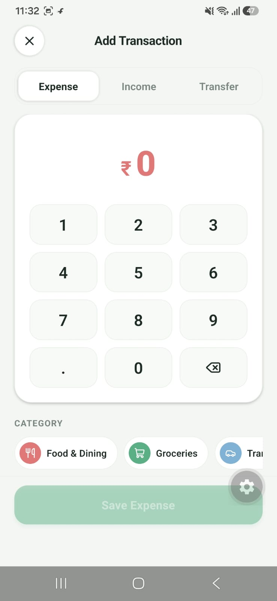<br />
      <b>04. Quick Expense Keypad</b><br />
      <i>Large soft keypad, category selector, and custom notes.</i>
    </td>
    <td width="33%" align="center">
      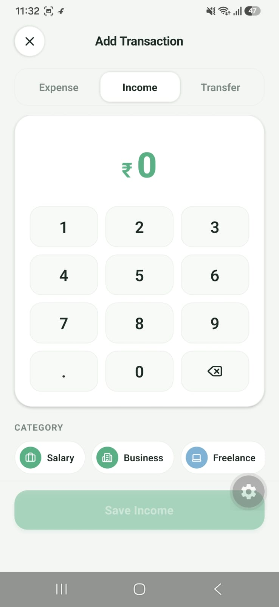<br />
      <b>05. Income Mode</b><br />
      <i>Emerald themed keypad for logging salary, business, and freelancing.</i>
    </td>
    <td width="33%" align="center">
      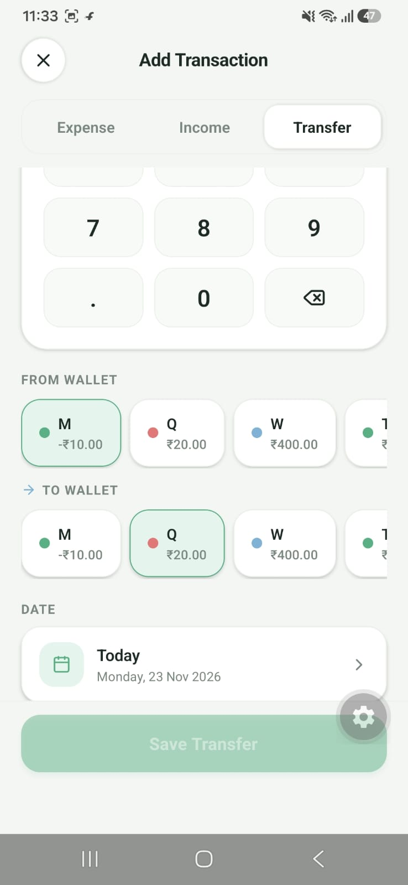<br />
      <b>06. Inter-Wallet Transfer</b><br />
      <i>Move money between Cash, Bank, and Cards with instant ledger sync.</i>
    </td>
  </tr>
</table>

---

### 3. Transactions Ledger & Detailed Insights
<table>
  <tr>
    <td width="50%" align="center">
      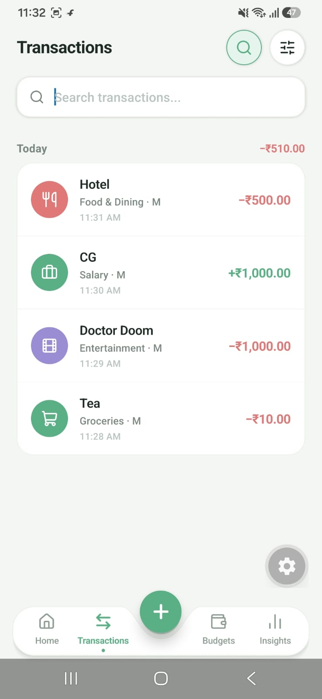<br />
      <b>03. Transaction Ledger & Search</b><br />
      <i>Grouped by date with category icons, search bar, and multi-filter bottom sheet.</i>
    </td>
    <td width="50%" align="center">
      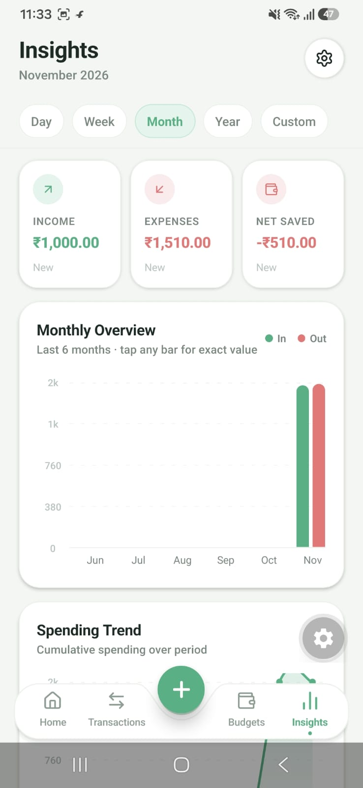<br />
      <b>07. Monthly Cash Flow Overview</b><br />
      <i>6-Month interactive bar chart comparing Inflow vs Outflow with Net Savings card.</i>
    </td>
  </tr>
</table>

---

### 4. Spending Trends, Encrypted Backups & Settings
<table>
  <tr>
    <td width="33%" align="center">
      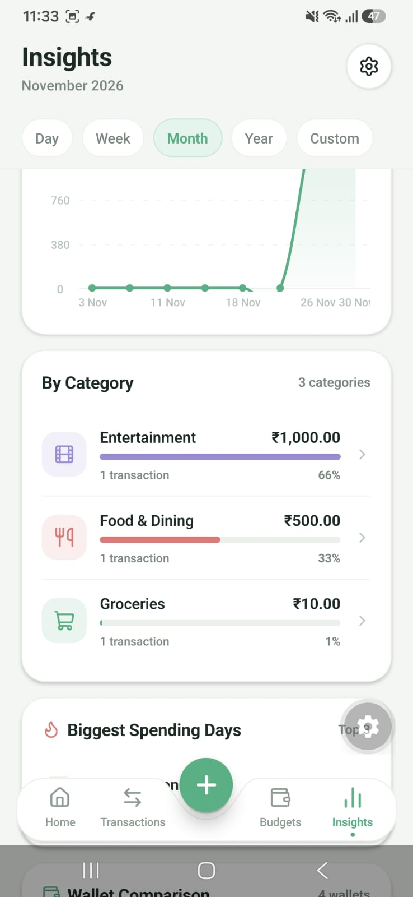<br />
      <b>08. Spending Trends & Categories</b><br />
      <i>Cumulative spend curve, top spend days, and category bars.</i>
    </td>
    <td width="33%" align="center">
      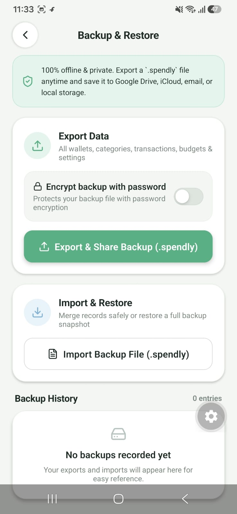<br />
      <b>09. 100% Offline Encrypted Backup</b><br />
      <i>Export/import `.spendly` files with optional password encryption.</i>
    </td>
    <td width="33%" align="center">
      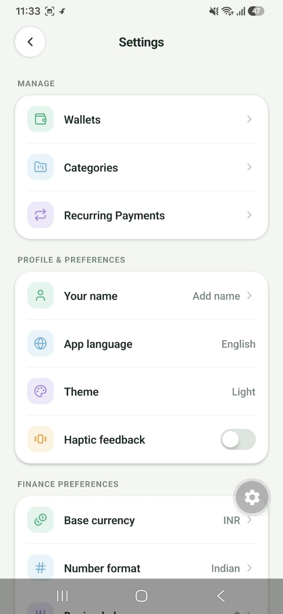<br />
      <b>10. Settings & Preferences</b><br />
      <i>Manage wallets, categories, recurring bills, soft switches, and currency format.</i>
    </td>
  </tr>
</table>

---

## 💎 Key Features & User Benefits (Fayda)

| Feature | Description | User Benefit (Fayda) |
| :--- | :--- | :--- |
| **🛡️ 100% Offline & Private** | Zero cloud servers, zero trackers. Everything is stored locally via SQLite on your device. | Your private financial data never leaks onto third-party servers. No spam calls or data breaches. |
| **🎨 Calming Soft UI** | Custom soft buttons, pastel color tokens, and pneumatic rounded cards. | Removes stress and anxiety commonly associated with tracking expenses. |
| **⚡ Rapid 3-Second Logging** | Custom in-app numeric pad with haptic feedback and category bubbles. | Never skip recording a cash payment. Record coffee or groceries before leaving the counter. |
| **💳 Multi-Wallet System** | Manage Cash, Savings Bank, Credit Cards, and Digital Wallets independently. | Real-time accurate net worth calculation with effortless transfer tracking. |
| **📊 Intelligent Insights** | Donut charts, 6-month comparative bar charts, and cumulative spend trajectories. | Understand exactly where your money leaks and make informed spending adjustments. |
| **🎯 Budget Limits & Alerts** | Set monthly category thresholds (e.g. Dining, Movies, Groceries) with visual progress meters. | Prevents overspending with gentle color-coded visual indicators. |
| **🔄 Recurring Subscriptions** | Auto-track recurring monthly bills (Netflix, Rent, Wi-Fi, Gym) with reminder notifications. | Never miss payment due dates or get surprised by recurring deductions. |
| **🔐 Biometric App Lock** | Protect app access with FaceID, TouchID, or Device Passcode with auto-timeout. | Complete peace of mind when lending your phone to friends or family. |
| **💾 Password-Protected Backups** | Export `.spendly` JSON snapshots protected by AES-encrypted passwords. | Easily migrate to a new device via Google Drive, WhatsApp, or email without losing history. |
| **🇮🇳 Indian & Global Currency Support** | Native INR (`₹`) formatting with Lakhs (`1,00,000`) and Crores, plus USD, EUR, GBP, JPY. | Native, natural reading format matching your everyday banking habits. |

---

## 📖 How to Use Spendly

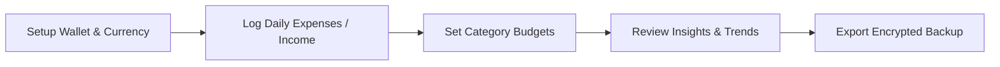

### Step 1: Set Up Your Wallets & Base Currency
1. On initial install, select your primary currency (e.g., **₹ INR** or **$ USD**).
2. Create your initial accounts in **Wallets** (e.g., `Cash`, `HDFC Bank`, `Credit Card`). You can assign custom icons and pastel color swatches to each.

### Step 2: Logging an Expense in 3 Seconds
1. Tap the floating **`+`** button in the bottom navigation bar.
2. Enter the amount on the custom soft keypad (e.g., `500`).
3. Tap the category (e.g., `Food & Dining` or `Groceries`).
4. Tap **Save Expense**. Your wallet balance and home analytics update immediately!

### Step 3: Transferring Money Between Accounts
1. Tap **`+`** and toggle the top switcher to **Transfer**.
2. Select **From Wallet** (e.g., `Bank`) and **To Wallet** (e.g., `Cash`).
3. Enter the amount and tap **Save Transfer**. Both balances are adjusted without counting as an expense or income!

### Step 4: Tracking Budgets & Visual Insights
1. Go to **Budgets** tab to set monthly limits for your high-spend categories.
2. Visit **Insights** to inspect your 6-month Inflow vs Outflow bar charts, category breakdowns, and top spending days.

### Step 5: Safe Backup & Data Portability
1. Go to **Settings** ➔ **Backup & Restore**.
2. Optionally toggle **Encrypt backup with password**.
3. Tap **Export & Share Backup (.spendly)** to save your snapshot to Google Drive, iCloud, or local files.

---

## 🛠️ Tech Stack & Architecture

Spendly is architected using modern, battle-tested React Native and Expo standards:

| Layer | Technology | Details |
| :--- | :--- | :--- |
| **Core Framework** | `React Native 0.88` & `React 19` | Universal component architecture with New Architecture support |
| **Runtime & SDK** | `Expo SDK 58` | Stable modular development ecosystem |
| **Routing** | `Expo Router v4` | File-based, typed routing with nested stacks and tab navigation |
| **Language** | `TypeScript 6` | 100% strict type safety and interface definitions |
| **Local Database** | `expo-sqlite` | Local ACID-compliant SQLite engine with structured schema migrations |
| **State Management** | `Zustand v5` | Lightweight, decoupled global stores (`settingsStore`, `tabBarStore`) |
| **Animations** | `React Native Reanimated 4` | High-performance 60fps UI animations and micro-interactions |
| **Gestures & Sheets** | `react-native-gesture-handler` & `@gorhom/bottom-sheet` | Native bottom-sheet modals with hardware back-handler support |
| **Charts** | `react-native-gifted-charts` & `react-native-svg` | Custom-styled donut charts, bar graphs, and spending trend curves |
| **Icons & Design** | `lucide-react-native` | Clean, modern vector glyphs with cohesive stroke weights |
| **Security & Haptics**| `expo-local-authentication`, `expo-haptics`, `expo-crypto` | Biometric authentication, tactile feedback, and crypto hashing |

---

## 📁 Project Structure

```
my-app/
├── app.json                  # Expo app configuration, splash screen & icons
├── assets/
│   └── images/
│       ├── icon.png          # 3D Rupee Wallet launcher icon (1024x1024)
│       ├── splash-icon.png   # Transparent 3D splash logo
│       └── UI-Images/        # Real device mobile UI screenshots
│           ├── 01_home_dashboard.png
│           ├── 02_spending_breakdown_donut.png
│           ├── 03_transactions_list.png
│           ├── 04_add_expense_keypad.png
│           ├── 05_add_income_modal.png
│           ├── 06_transfer_funds_modal.png
│           ├── 07_insights_monthly_overview.png
│           ├── 08_insights_category_trend.png
│           ├── 09_backup_and_restore.png
│           └── 10_settings_preferences.png
├── src/
│   ├── app/                  # File-based navigation routes
│   │   ├── _layout.tsx       # Root layout, Animated Splash & Biometric lock
│   │   ├── (tabs)/           # Main tab screens (Home, Transactions, Budgets, Insights)
│   │   ├── (onboarding)/     # First-time user welcome & currency setup
│   │   ├── (settings)/       # Settings, categories, recurring payments & backup
│   │   └── modals/           # Add Transaction, Add Account modals
│   ├── components/
│   │   ├── cards/            # Summary cards, wallet balance cards, chart containers
│   │   ├── common/           # AnimatedSplashScreen, SoftSwitch, CustomAlert
│   │   ├── sheets/           # FilterSheet, AddBudgetSheet, DatePickers
│   │   └── ui/               # Primary buttons, text inputs, segmented pills
│   ├── database/             # SQLite migrations, schema, and repositories
│   ├── services/             # BackupService, RecurringService, NotificationService
│   ├── store/                # Zustand state stores
│   └── theme/                # Color tokens, typography, shadows & shapes
├── package.json
└── tsconfig.json
```

---

## 🚀 Getting Started

Follow these steps to run Spendly on your local machine or physical mobile device:

### Prerequisites
- [Node.js (v18 or newer)](https://nodejs.org/)
- [npm](https://www.npmjs.com/) or [pnpm](https://pnpm.io/)
- [Expo Go](https://expo.dev/go) app on your Android/iOS device, or Android Studio / Xcode emulator

### Installation & Launch

1. **Clone the repository:**
   ```bash
   git clone https://github.com/your-username/spendly.git
   cd my-app
   ```

2. **Install project dependencies:**
   ```bash
   npm install
   ```

3. **Start the Expo development server:**
   ```bash
   npx expo start
   ```

4. **Run on your device:**
   - **Android Device**: Scan the QR code with the Expo Go app.
   - **Android Emulator**: Press `a` in the terminal.
   - **iOS Simulator**: Press `i` in the terminal (macOS only).
   - **Web Preview**: Press `w` in the terminal.

### Production Type-Check & Lint
```bash
# Run TypeScript compilation check
npx tsc --noEmit

# Run code linter
npm run lint
```

---

## 🔒 Privacy & Security Guarantee

- **Zero Network Calls for User Data**: Spendly does not communicate with any external analytics or tracking servers.
- **Biometric Guard**: If enabled, the app asks for authentication immediately upon launch and re-locks after 60 seconds of background inactivity.
- **Self-Contained Backups**: All backup `.spendly` files are standard JSON formatted with optional password-based AES encryption.

---

## ⛔ Strict Intellectual Property, Anti-Cloning & Commercial Use Notice

> [!CAUTION]
> ### STRICTLY PROPRIETARY • NO CLONING • NO COMMERCIAL USE
> **All Rights Reserved (c) 2026 Spendly.**
> 
> This application, including all its source code, assets, UI/UX designs, animations, sound/haptic configurations, and software architecture, is the **exclusive proprietary intellectual property** of the author.
>
> 1. **No Commercial Use**: You are **STRICTLY PROHIBITED** from using, deploying, monetizing, sublicensing, selling, or repackaging this codebase, either in whole or in part, for any commercial venture, freelance assignment, paid template, client app, or business service.
> 2. **Prohibition on Cloning & Forking**: Cloning, copying, mirroring, web-scraping, reproducing, or hosting public or private forks of this repository is strictly forbidden without prior explicit written permission from the copyright owner.
> 3. **No App Store Publishing**: You may **NOT** publish, submit, or distribute this application or any derivative version to Google Play Store, Apple App Store, F-Droid, or any digital marketplace.
> 4. **Legal Enforcement**: Any unauthorized duplication, commercial exploitation, or copyright infringement will be met with immediate DMCA takedown actions and formal legal proceedings under applicable international copyright and intellectual property laws.

---

## 📄 License & Terms of Use

This repository is governed by the **[PROPRIETARY & CONFIDENTIAL LICENSE](LICENSE)**. 

- Viewing of the source code is permitted for educational reference and inspection purposes only.
- Commercial usage, redistribution, and unauthorized cloning are strictly prohibited.
- For commercial licensing inquiries or permissions, contact the repository owner.

<div align="center">
  <sub>Crafted with precision, calmness, and ❤️ for mindful personal finance.</sub>
</div>
